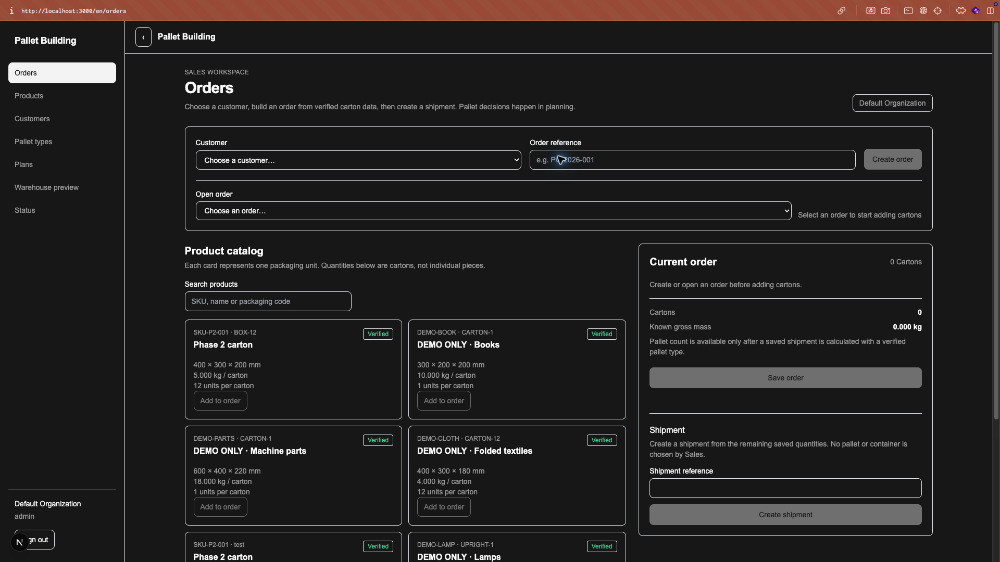
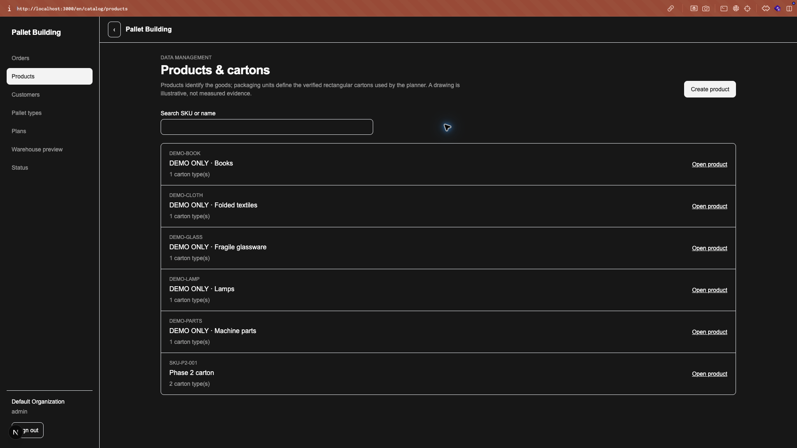
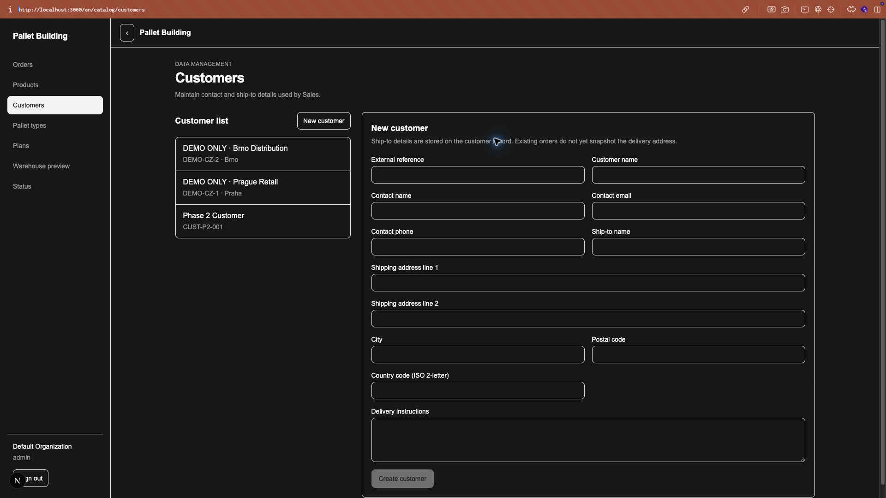
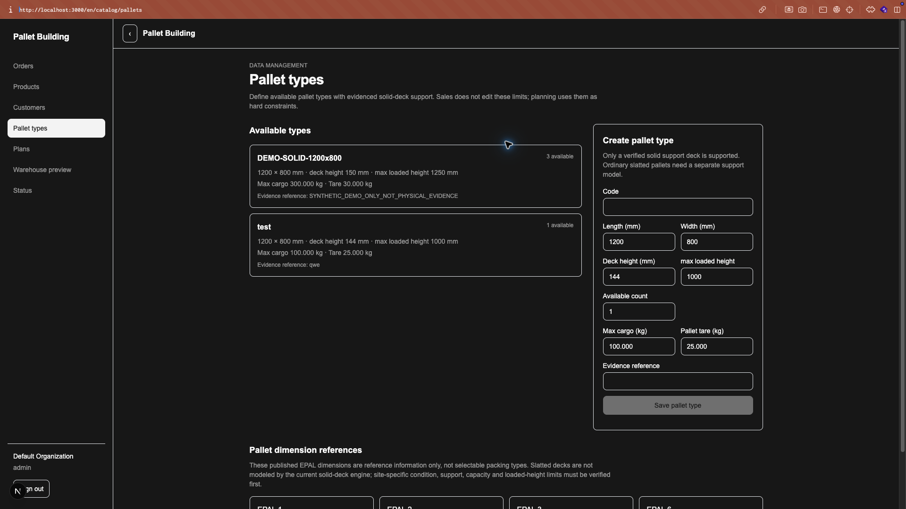
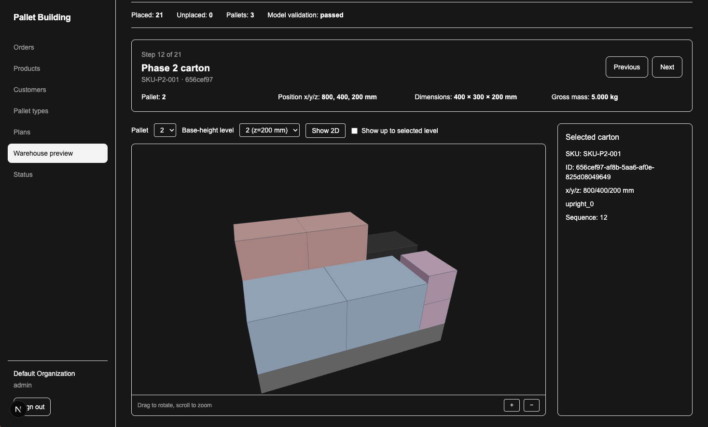
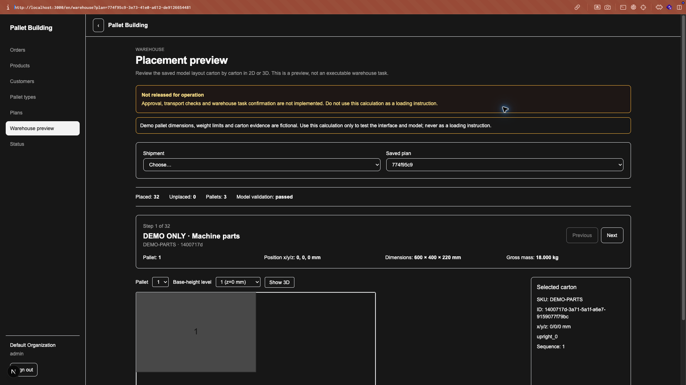
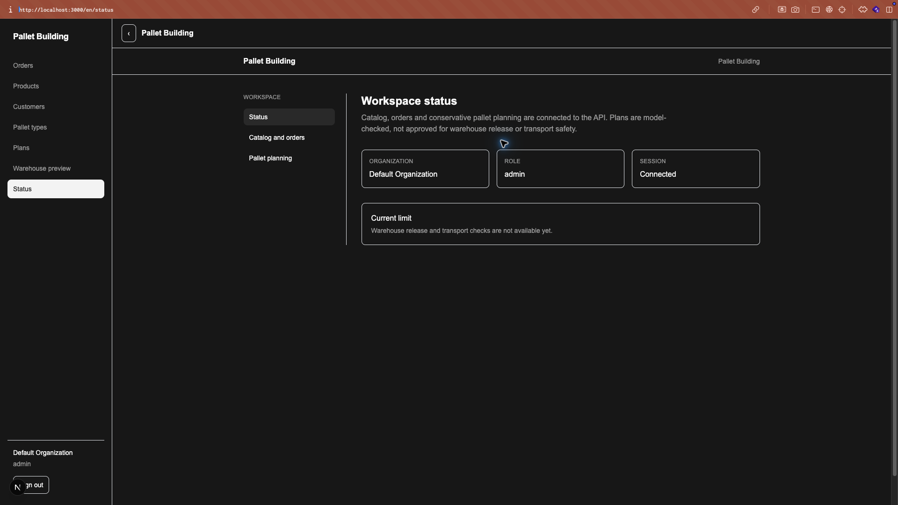
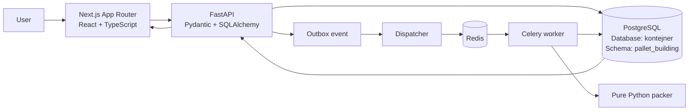

<div align="center">

# Pallet Building

### Explainable pallet planning for rectangular cartons
### Vysvětlitelné plánování palet pro pravoúhlé kartony

Sales, catalog and planning workflows connected to a FastAPI backend, an asynchronous Python packer and a synchronized 2D/3D plan viewer.

Pallet Building propojuje katalog, objednávky a plánování s FastAPI backendem, asynchronním Python packerem a synchronizovaným 2D/3D viewerem.

<p>
  
  
  
  
  
  
  
</p>

</div>

---

## Overview / Přehled

**Pallet Building** is a full-stack application for turning verified carton and shipment data into a reproducible, inspectable pallet layout. It is designed around a simple chain:

```text
Catalog → Order → Shipment → Preflight → Async calculation → Plan viewer
```

The current implementation supports rectangular cartons on supported solid-deck pallets. It calculates a deterministic **Quick** baseline and a bounded **Best fit** search, stores immutable input and layout snapshots, validates the result independently and displays the saved layout in 2D and 3D.

The product UI is English and the current interface is scoped to one default organization. The existing PostgreSQL database is named **`kontejner`**; application tables live in the isolated **`pallet_building`** schema.

## Important scope note

The application is currently a development and model-validation increment. A calculated plan is **not** an approved loading instruction and does not certify real-world stability, transport safety or a global optimum.

- Only complete, verified rectangular cartons are planned.
- Side-lay is prohibited and unknown top-load limits prevent stacking.
- Vertical stacking currently requires an exact-footprint, single-support column.
- Every physical carton instance is retained as either `placed` or `unplaced`.
- The warehouse page is a read-only preview; it does not confirm execution.
- Approval, executable warehouse tasks, transport checks, container loading, import/export and offline sync are not implemented yet.

See [`docs/capability-matrix.md`](docs/capability-matrix.md) for the verified capability boundary and [`docs/implementation-status.md`](docs/implementation-status.md) for the latest local evidence.

## Application screenshots / Screenshoty aplikace

The screenshots below show the main connected UI surfaces: sales orders, catalog administration, pallet planning, visualization and warehouse preview.

> The displayed `DEMO-*` dimensions, limits and carton data are synthetic development fixtures. They are included to demonstrate the interface, not to provide operational loading evidence.

### Sales and catalog

<table>
<tr>
<td width="50%">
  
  <p align="center"><b>Orders workspace</b><br>Sales creates orders from verified carton data and prepares shipments.</p>
</td>
<td width="50%">
  
  <p align="center"><b>Products and cartons</b><br>Products and verified rectangular packaging units used by planning.</p>
</td>
</tr>
<tr>
<td width="50%">
  
  <p align="center"><b>Customers</b><br>Contact and ship-to data used by the Sales workflow.</p>
</td>
<td width="50%">
  
  <p align="center"><b>Pallet types</b><br>Solid-deck pallet dimensions, capacity and evidence references.</p>
</td>
</tr>
</table>

### Planning and warehouse

<table>
<tr>
<td width="50%">
  
  <p align="center"><b>Planning and pallet visualization</b><br>Saved plan metrics, candidate strategy and 2D/3D layout inspection.</p>
</td>
<td width="50%">
  
  <p align="center"><b>Warehouse preview</b><br>Step-by-step read-only review of saved carton placements.</p>
</td>
</tr>
</table>

### Workspace status

<p align="center">
  
</p>

The warehouse screen is intentionally a preview only. It has no operational confirmation control and must not be used as a loading instruction.

## Key features / Hlavní funkce

### Sales and catalog

- Role-aware Sales, Warehouse and Admin workspaces.
- Customer records with contact and ship-to fields.
- Product and packaging-unit catalog with integer millimetre dimensions and gram weights.
- Packaging verification for carton evidence, upright 90-degree rotation and top-load data.
- POS-like order editor that distinguishes sales units, cartons and shipment quantities.
- Revision-aware cart replacement and conflict handling.
- Solid-deck pallet types with read-only equipment reference information.

### Planning and validation

- Shipment preflight that reports missing or unsupported input before a run starts.
- Immutable snapshots of planning input, search strategy, algorithm version and layout.
- Redis/Celery execution outside the HTTP request handler.
- Idempotent run creation using an idempotency key, outbox dispatch and worker lease/fencing.
- Deterministic Quick packing and bounded Best fit candidate comparison.
- Independent checks for conservation, geometry, pallet boundaries, exact support, column loads and instruction order.
- Explicit placed/unplaced accounting; no silent dropping or invented full cartons.

### Plan inspection

- Saved plan comparison with persisted metrics.
- Interactive 2D drawing and React Three Fiber 3D layout.
- Shared selection between tree, drawing, 3D scene and inspector.
- SKU-based stable legend colors, including plans with multiple packaging groups for one SKU.
- Height-prefix display for reviewing the order in which placements become available.

## System architecture / Architektura



The backend owns authorization, organization scoping, business validation, snapshots and API contracts. The worker owns CPU-heavy calculation. The packer is deliberately independent of FastAPI, SQLAlchemy and the database so it can be tested as a pure library.

```text
Browser
  ↓
Next.js UI → openapi-fetch → FastAPI → PostgreSQL
                                      ↓
                                  outbox event
                                      ↓
                              Redis + Celery worker
                                      ↓
                              pure Python packer
```

### Data and unit rules

| Data | Storage and API rule | UI rule |
|---|---|---|
| Dimensions and coordinates | Integer `mm` | Formatted as metric dimensions |
| Mass and payload | Integer `g` | Displayed as `kg` |
| Money | Integer minor units plus currency | No floating-point accounting |
| Time | UTC `timestamptz` | Organization timezone, default `Europe/Prague` |
| Plan history | Immutable input/layout snapshot | Rendered from the saved snapshot |

## Project structure / Struktura projektu

```text
.
├── apps/
│   ├── api/
│   │   ├── src/app/
│   │   │   ├── main.py              # FastAPI app, auth, catalog and order endpoints
│   │   │   ├── planning.py          # Preflight, run creation and saved-plan endpoints
│   │   │   ├── schemas.py           # Pydantic request/response contract
│   │   │   ├── models.py            # SQLAlchemy organization, catalog and plan models
│   │   │   ├── db.py                # Database engine, sessions and declarative base
│   │   │   ├── config.py            # Environment-backed application settings
│   │   │   ├── dependencies.py      # Current-user lookup and role guards
│   │   │   ├── security.py          # Password hashing, session secrets and digests
│   │   │   ├── tasks.py             # Snapshot processing and Celery task entrypoint
│   │   │   ├── dispatcher.py        # Claims outbox events and enqueues work
│   │   │   └── cli.py               # Explicit local user/bootstrap command
│   │   ├── migrations/              # Alembic migrations for pallet_building
│   │   ├── scripts/
│   │   │   ├── export_openapi.py    # Export the backend OpenAPI document
│   │   │   └── seed_demo.py         # Opt-in, idempotent DEMO-* development fixtures
│   │   ├── tests/                   # API security, roles, conflicts and planning tests
│   │   └── pyproject.toml           # API dependencies and Ruff/Pytest settings
│   └── worker/
│       └── celery_app.py            # Worker-side Celery application wiring
├── packages/
│   └── packer/
│       ├── src/pallet_building_packer/
│       │   ├── core.py              # Carton/pallet models, Quick/Best fit and validation
│       │   └── __init__.py          # Public packer package surface
│       ├── tests/                   # Packing, support and instruction-sequence tests
│       └── pyproject.toml           # Dependency-free packer package configuration
├── apps/web/
│   ├── src/app/[locale]/             # Localized Next.js routes
│   ├── src/components/
│   │   ├── app-shell.tsx            # Sidebar, role navigation and application shell
│   │   ├── sales-orders-page.tsx    # Sales order and shipment editor
│   │   ├── products-list-page.tsx   # Product catalog list
│   │   ├── product-create-page.tsx  # Product and packaging creation form
│   │   ├── product-detail-page.tsx  # Product detail and interactive carton view
│   │   ├── customers-page.tsx       # Customer and ship-to editor
│   │   ├── pallet-types-page.tsx    # Solid-deck pallet management
│   │   ├── planning-workspace.tsx   # Plan controls, tree, inspector and comparison
│   │   ├── planning-page.tsx        # Plan data loading and 2D plan drawing
│   │   ├── pallet-scene.tsx         # Saved-layout React Three Fiber scene
│   │   ├── warehouse-preview-page.tsx # Read-only step-prefix preview
│   │   └── login-form.tsx           # Login form and client validation
│   ├── src/lib/
│   │   ├── api/openapi.json        # Generated OpenAPI source document
│   │   ├── api/schema.d.ts         # Generated TypeScript API types
│   │   ├── api/client.ts           # openapi-fetch client wrapper
│   │   ├── coordinates.ts          # mm-to-m scene coordinate adapter
│   │   └── legend-skus.ts          # Stable unique SKU legend entries
│   ├── messages/en.json             # English i18n messages
│   └── package.json                 # Frontend scripts and dependencies
├── infra/compose.yaml               # Disposable local PostgreSQL and Redis services
├── docs/
│   ├── PALLET_BUILDING_SPEC.md      # Full product and technical specification
│   ├── repository-audit.md          # Evidence-based repository audit
│   ├── implementation-status.md     # Verified progress and known limitations
│   ├── capability-matrix.md         # Capability-by-capability release boundary
│   ├── benchmarks-phase4.md         # Reproducible local benchmark evidence
│   ├── database-schema-decision.md  # Existing kontejner DB and public-schema decision
│   ├── equipment-reference.md       # Equipment references and their limitations
│   └── adr/                         # Architecture decision records
├── package.json                     # Root frontend/codegen commands
└── pnpm-lock.yaml                   # Locked JavaScript dependency graph
```

## User flow / Uživatelský průchod

1. **Login** — the API creates a server-side session and applies role and organization checks.
2. **Catalog** — Admin maintains products, complete packaging units and supported pallet types.
3. **Order** — Sales selects a customer, adds complete-carton quantities and saves the cart with revision conflict protection.
4. **Shipment** — a shipment is created from available order quantities without confusing pieces and cartons.
5. **Preflight** — Warehouse or Admin selects a pallet and receives blockers before computation.
6. **Run** — the API snapshots the shipment and enqueues an idempotent asynchronous calculation.
7. **Plan** — the worker runs Quick or bounded Best fit, validates the result and persists an immutable plan version.
8. **Inspect** — users review metrics, unplaced reasons, 2D/3D layout and placement prefixes.

The current `/en/warehouse` route stops at inspection. It intentionally has no operational confirmation control.

## Routes

| Route | Purpose | Main roles |
|---|---|---|
| `/en/login` | Sign in | All |
| `/en/orders` | Sales order and shipment editor | Sales, Admin |
| `/en/catalog/products` | Product catalog | Sales, Admin |
| `/en/catalog/products/new` | Create product and packaging data | Admin |
| `/en/catalog/products/:id` | Inspect a product and carton dimensions | Sales, Admin |
| `/en/catalog/customers` | Customers and delivery fields | Sales, Admin |
| `/en/catalog/pallets` | Solid-deck pallet types and references | Admin |
| `/en/planning` | Run and inspect saved plans | Warehouse, Admin, Sales read-only |
| `/en/warehouse` | Read-only placement preview | Warehouse, Admin |
| `/en/status` | Health/readiness information | All |
| `/en/workspace` | Compatibility redirect to Orders | All |

## Getting started

### Prerequisites

- Python 3.12 or newer
- Node.js 22
- pnpm 10.17.0
- PostgreSQL with the existing database named `kontejner`
- Redis for asynchronous plan runs
- Docker only if you use the disposable local services in `infra/compose.yaml`

### Install dependencies

```sh
python3 -m venv .venv
.venv/bin/python -m pip install -e 'apps/api[test]' -e packages/packer
pnpm install --frozen-lockfile
pnpm --dir apps/web install --frozen-lockfile
```

Configure `DATABASE_URL` and `REDIS_URL` privately. Do not commit, print or paste secrets and complete connection strings into issues or logs.

### Apply migrations and start the API

```sh
DATABASE_URL="$DATABASE_URL" .venv/bin/alembic -c apps/api/alembic.ini upgrade head
DATABASE_URL="$DATABASE_URL" PYTHONPATH=apps/api/src:packages/packer/src \
  .venv/bin/python -m app.cli --password 'your-local-dev-password'
PYTHONPATH=apps/api/src:packages/packer/src \
  .venv/bin/uvicorn app.main:app --reload --port 8000
```

Migrations and the seed are explicit and do not run at application startup. The application uses only the `pallet_building` schema and leaves legacy `public` objects untouched.

### Start the frontend, dispatcher and worker

```sh
pnpm --dir apps/web dev

PYTHONPATH=apps/api/src:packages/packer/src \
  .venv/bin/python -m app.dispatcher

PYTHONPATH=apps/api/src:packages/packer/src \
  .venv/bin/celery -A app.tasks.celery_app worker \
  --loglevel=info --pool=solo --concurrency=1
```

The `solo` worker options are recommended for the documented local macOS/Python 3.14 smoke environment. Production worker-pool behavior still needs separate deployment verification.

### Optional development fixtures

```sh
PYTHONPATH=apps/api/src:packages/packer/src \
  .venv/bin/python apps/api/scripts/seed_demo.py

PYTHONPATH=apps/api/src:packages/packer/src \
  .venv/bin/python apps/api/scripts/seed_demo.py --execute
```

The first command previews changes. The second inserts missing `DEMO-*` records only when `APP_ENV=development`. Fixtures are synthetic and are not physical packaging evidence.

For an isolated disposable stack, inspect the compose configuration first and then run:

```sh
docker compose -f infra/compose.yaml up -d
```

Never point tests or destructive scripts at operational data.

## Development checks

Use the separate `pallet_building_test` database for database tests. The integration suite refuses other database names.

```sh
.venv/bin/ruff check apps/api packages/packer
PYTHONPATH=apps/api/src:packages/packer/src .venv/bin/mypy \
  --follow-imports=silent --ignore-missing-imports \
  apps/api/src/app packages/packer/src/pallet_building_packer
PYTHONPATH=apps/api/src:packages/packer/src \
  .venv/bin/pytest apps/api/tests packages/packer/tests -q
PYTHONPATH=apps/api/src:packages/packer/src \
  .venv/bin/python apps/api/scripts/export_openapi.py
pnpm contract:generate
pnpm --dir apps/web lint
pnpm --dir apps/web typecheck
pnpm --dir apps/web test
pnpm --dir apps/web build
```

The generated OpenAPI document and TypeScript types are part of the contract. If Pydantic schemas change, regenerate the contract and check for drift. Do not run `next build` and `next dev` simultaneously because both use `apps/web/.next`.

## What is not implemented yet

The following are intentionally outside the current verified increment:

- immutable plan approval and release workflow;
- executable warehouse tasks, confirmation and issue handling;
- transport-condition evaluation and professional operational review;
- multi-support stability model and physical packaging validation;
- containers, ULDs, floor-loaded modes, unloading priorities and cost comparison;
- import/export and offline warehouse synchronization;
- production deployment and unattended worker recovery;
- actual physical load-bearing evidence.

These limits are product boundaries, not hidden TODOs. See the specification and capability matrix before extending the release claims.

## Documentation

- [`docs/PALLET_BUILDING_SPEC.md`](docs/PALLET_BUILDING_SPEC.md) — complete product and technical specification.
- [`docs/repository-audit.md`](docs/repository-audit.md) — what was inspected and what was verified.
- [`docs/implementation-status.md`](docs/implementation-status.md) — current implementation evidence and next gated increment.
- [`docs/capability-matrix.md`](docs/capability-matrix.md) — capability support, limits and release status.
- [`docs/benchmarks-phase4.md`](docs/benchmarks-phase4.md) — local benchmark inputs and results.
- [`docs/adr/`](docs/adr/) — recorded architecture decisions.

## Credits and AI disclosure

Pallet Building was created with the assistance of AI tools. AI was used for implementation support, code drafting, documentation and review suggestions. Product decisions, safety boundaries, source-code review, validation of claims and final responsibility remain with the project owner and maintainers.

The project does not use an AI model as the authority for pallet validation. The current calculation is a deterministic local Python heuristic with explicit, independently checked limits. No D-Wave, Ocean, Leap or external quantum solver is used.

## License

No license has been declared yet. Until a license is added to the repository, all rights remain with the project owner.
